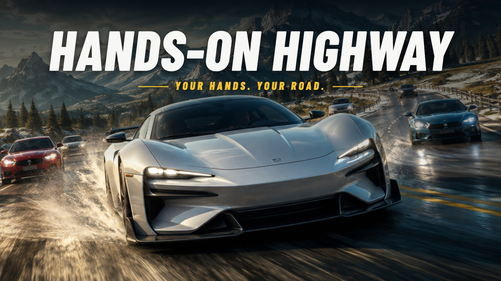
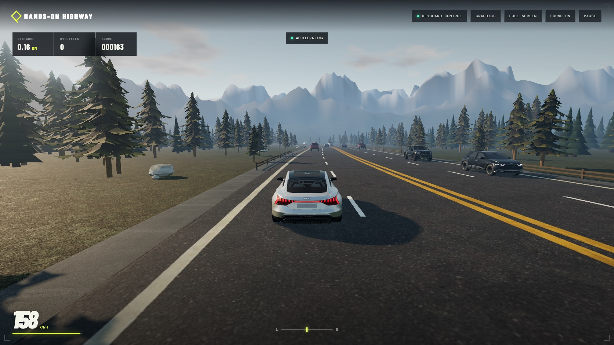
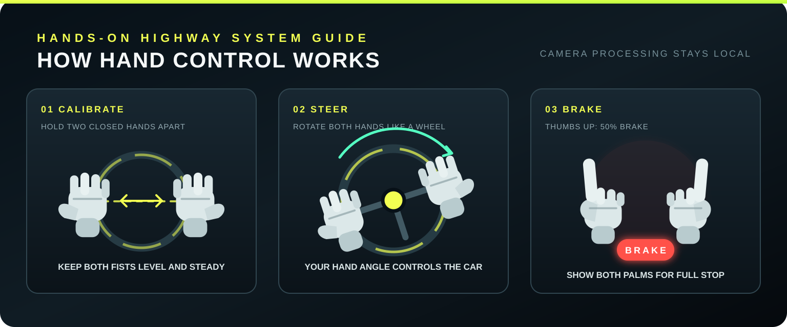

# Hands-On Highway



**Steer with your bare hands.** Hands-On Highway is a free browser driving game where your webcam is the controller: hold up two fists like a steering wheel and turn them to steer down a four-lane mountain highway, dodging same-direction and oncoming traffic. No download, no controller, no account.

**[▶ Play in your browser](https://iakashkanaujiya.github.io/car_driving/)** (Chrome or Edge on a computer with a webcam; keyboard controls work too.)

Hand tracking runs entirely on your device with MediaPipe, so camera video is never uploaded. The car accelerates automatically; slowing down for curves and traffic is up to you.

## Gameplay



## Run locally

```bash
npm install
npm run dev
```

Open the local URL shown by Vite in Chrome or Edge. Camera access works on `localhost` or an HTTPS deployment.

## Deploy to GitHub Pages

Push the project to a repository named `car_driving` using the `main` branch. In **Settings → Pages**, select **GitHub Actions** as the deployment source. The included workflow tests and deploys the game automatically to:

```text
https://<your-github-username>.github.io/car_driving/
```

## Time of day and weather

Pick the conditions on the start screen, or change them mid-run under **Graphics → Conditions**. Your choice is saved for future visits.

- **Time of day:** Day (high afternoon sun), Evening (a low sunset straight ahead with long shadows) or Night (moonlight, stars, and every car driving with its lights on).
- **Weather:** Clear, Cloudy (broken cloud and softer shadows), Rain (an overcast sky, falling rain, a glossy wet road, rain sound, and headlights on) or Fog (visibility drops to a couple of hundred metres and headlights come on).

Any time of day combines with any weather, so night fog or evening rain are available too.

## Available car models

Choose any of these vehicles directly on the start screen. Traffic reuses the same model collection with randomized realistic paint colors.

| Vehicle                          | Driver car | Traffic car |
| -------------------------------- | :--------: | :---------: |
| 2017 Ford F-150 Raptor (default) |    Yes     |     Yes     |
| 2023 Ford Everest Sport          |    Yes     |     Yes     |
| Hyundai Ioniq 5                  |    Yes     |     Yes     |
| 2018 Audi e-tron GT Concept      |    Yes     |     Yes     |

You can select 0, 4, 8, 12, or 16 traffic cars and choose how many different models appear. Car variety defaults to 1, which reuses the selected driver model for traffic and reduces model parsing and memory use. Higher traffic counts or model variety may reduce frame rates on lower-powered devices.

On the first visit, a setup popup keeps the game locked while it downloads approximately 11 MB of core scenery and road textures with live progress. Only selected car models are downloaded afterward; each model is stored on first use and reused on later visits. Interrupted core downloads can be retried and resume from files that are already cached.

## Controls



- **Hand mode:** hold two closed hands apart, keep them level during calibration, and rotate them like a steering wheel. Raise both thumbs for 50% braking or show both open palms for a full stop.
- **Keyboard mode:** use `W` or up arrow to accelerate, `S` or down arrow to brake, and `A` / `D` or left / right arrows to steer. Braking stops at zero; there is no reverse gear.
- **Pause:** use the Pause button or press `Escape`.
- **Performance diagnostics:** press `F3` to toggle the performance HUD. Add `?perf=1` to the URL to open it automatically.
- **Graphics:** open Graphics in the top bar to choose Auto, Low, Medium, or High quality. Low renders directly for speed; Medium and High add HDR bloom, MSAA, colour grading and a denser photoreal forest band. The same panel sets the time of day and weather. All choices are saved locally.

Hand-control mode accelerates automatically and only brakes on its own when it loses your hands. Keyboard mode uses manual acceleration and braking. Neither mode brakes for traffic or curves, so watch the road ahead. The road has four lanes and traffic drives on the left: the two left lanes carry traffic going your way, so overtake in the inner one, and the two right lanes carry oncoming vehicles.

## Rendering

The valley is lit and shaded as one physically based system:

- **Sky and lighting:** a Preetham atmospheric sky with drifting procedural cumulus is both the backdrop and the source of a prefiltered environment map, so car paint, glass and chrome reflect the same sky the player sees. The sun light, shadows, sky disc and haze share one direction (`src/game/world/atmosphere.ts`).
- **Aerial perspective:** three.js fog chunks are replaced with exponential height fog integrated along each view ray and tinted toward the sun, so distant summits fade into the horizon realistically.
- **Terrain:** a seamless ring of ridged-noise mountains with altitude- and slope-based snow, rock and forest colouring replaces the old landscape download. Instanced conifers fill the valley, and the meadow uses world-space macro variation to hide texture tiling.
- **Cars:** every model gets a soft contact shadow, and roll and pitch are applied to the sprung body only, so the tyres stay planted while the body leans through corners and dives under braking.
- **Conditions:** each time of day and weather is one set of values (`src/game/world/conditions.ts`) shared by the sky, sun or moon light, shadows, fog and reflections. The fog's sun-scatter direction is a uniform every material shares, so switching conditions needs no shader rebuild. At night the player's headlights are a real spot light; traffic lamps are one draw call of glow sprites plus one instanced draw of light pools on the road. Rain is a single GPU-animated draw of streaks that slant with your speed and catch your headlight beam. Under a full rain cloud the sun or moon and its shadow pass switch off.

## Architecture

The runtime is organized by responsibility:

- `src/app` coordinates menus, input mode, asset readiness, and game lifecycle.
- `src/game/simulation` contains deterministic gameplay rules that can be tested without WebGL.
- `src/game/world` owns reusable Three.js scene systems (sky, atmosphere, mountains, forest, fences) and their GPU-resource lifecycle.
- `src/game/rendering` contains quality tiers, post-processing and material shader extensions.
- `src/ui` renders the static shell, startup gate, and HUD.
- `src/audio` owns the procedural Web Audio graph.
- `src/controls` contains keyboard and hand-tracking input adapters.
- `src/diagnostics` contains opt-in runtime measurements that stay disabled during normal play.

Keep game rules deterministic by passing state in and returning results. DOM and Three.js mutations should stay at the edges, and every scene system that allocates GPU resources should expose `dispose()`.

## Checks

```bash
npm test
npm run build
```

The MediaPipe runtime and hand model are copied into `public/mediapipe` during `npm install`, so camera processing happens on the device without uploading video.

## License

Original Driftline source code and documentation are available under the [Driftline Non-Commercial License](LICENSE). Commercial or for-profit use is prohibited without prior written permission. Third-party assets retain their respective licenses and attribution requirements.

## 3D asset credits

- [2017 Ford F-150 Raptor](https://sketchfab.com/3d-models/2017-ford-f-150-raptor-2be278ef4dc94d9fa00fae8b33da8273) by [Ddiaz Design](https://sketchfab.com/ddiaz-design), licensed under [CC BY-NC-SA 4.0](http://creativecommons.org/licenses/by-nc-sa/4.0/).
- [2023 Ford Everest Sport](https://sketchfab.com/3d-models/ford-everest-sport-2023-c37bec0353a94f90a3acbe09ceb3aecf) by [Asadawut.Kaewma](https://sketchfab.com/Asadawut.Kaewma), licensed under [CC BY 4.0](http://creativecommons.org/licenses/by/4.0/).
- [Hyundai Ioniq 5](https://sketchfab.com/3d-models/hyundai-ioniq-5-lowpoly-675e78311e8440d88714bd212cb7a8fb) by [andikapratamaw](https://sketchfab.com/andikapratamaw), licensed under [CC BY 4.0](http://creativecommons.org/licenses/by/4.0/).
- [2018 Audi e-tron GT Concept](https://sketchfab.com/3d-models/2018-audi-e-tron-gt-concept-e35726151c9e4a169c005d54509715fa) by [Ddiaz Design](https://sketchfab.com/ddiaz-design), licensed under [CC BY-NC-SA 4.0](http://creativecommons.org/licenses/by-nc-sa/4.0/).
- [Pine Tree](https://sketchfab.com/3d-models/pine-tree-d45218a3fab349e5b1de040f29e7b6f9) by [evolveduk](https://sketchfab.com/evolveduk), licensed under [CC BY 4.0](http://creativecommons.org/licenses/by/4.0/).

Attribution and license metadata are also embedded in each GLB file.
